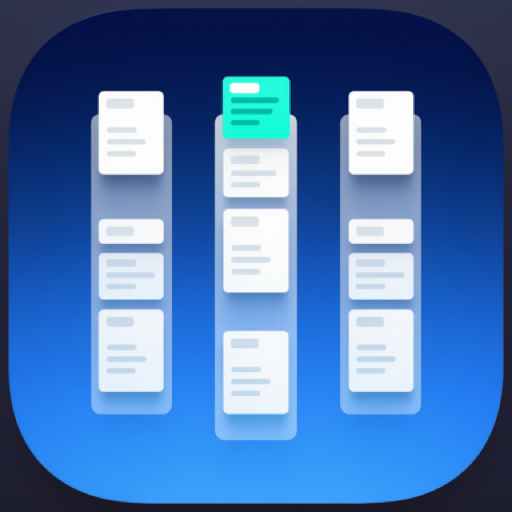
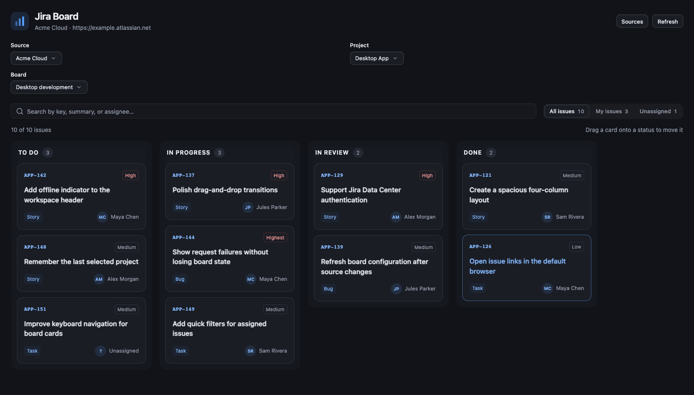
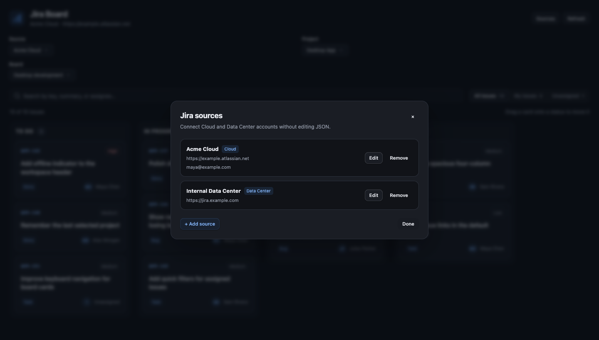

<div align="center">
  

  <h1>Jira Board for OpenChamber</h1>

  <p><strong>A spacious Kanban board for Jira Cloud and Jira Data Center, right inside your OpenChamber workspace.</strong></p>

  <p>Multiple Jira sources · Project and board switching · Search and assignee filters · Drag-and-drop transitions</p>

</div>

<picture>
  <source media="(prefers-color-scheme: dark)" srcset="docs/assets/board-dark.png">
  <source media="(prefers-color-scheme: light)" srcset="docs/assets/board-light.png">
  
</picture>

> Screenshots show the actual extension interface with fictional Jira data. The theme follows OpenChamber automatically.

## Why Jira Board?

- **Keep work close to your workspace.** Check priorities, find an issue, and move it forward without opening another Jira tab.
- **Bring different Jira sites together.** Switch between Jira Cloud and self-hosted Data Center sources from one panel.
- **Work with the board you already know.** Jira columns, statuses, assignees, issue types, and priorities come from your board configuration.
- **Change status, not just view it.** Drag cards between columns or onto a specific status when a column contains several statuses.
- **Add sources without editing JSON.** A structured Source Manager handles Cloud and Data Center fields, while credentials stay in the local extension data directory.

## Features

- Jira Cloud using email + API token, and Jira Data Center using a personal access token.
- Up to 16 independently configured Jira sources.
- A built-in **Source Manager** with structured fields, add/edit/remove actions, and credential-preserving edits.
- Source, project, and Jira Software board selectors, including **All projects**.
- Restored source, project, board, and assignee-filter selections.
- Fast client-side search by issue key, summary, type, or assignee.
- **All issues**, **My issues**, and **Unassigned** filters.
- Issue links that open directly in Jira.
- Optimistic drag-and-drop updates with rollback on rejected transitions.
- Reconciliation when a connection failure leaves a transition outcome uncertain.
- Light and dark themes through OpenChamber's native theme tokens.

## Requirements

- OpenChamber **2.7.2 or newer**, on desktop or web. Extension services are not available on mobile or in VS Code.
- Jira Software Cloud or a Jira Data Center instance with the Agile API.
- A Jira account allowed to view the relevant projects and boards. Changing status also requires permission to execute the workflow transition.

Bun is **not required to install the downloaded package** because the built panel and service are included in this repository. Bun is only needed to rebuild or develop the extension.

## Install

### Option 1: Download the ZIP

1. [Download the latest source ZIP](https://github.com/DeoEsor/openchamber-jira-board/archive/refs/heads/main.zip) and unzip it.
2. In OpenChamber, open **Settings → Extensions** and install the unzipped folder as a local extension.
3. Approve the **local service** when prompted.
4. Open **Jira Board** from the extension rail. For a wider view, open it from the **+** menu as a dialog.
5. Click **+ Add source** and continue with [Connect Jira](#connect-jira).

### Option 2: Clone with Git

```bash
git clone https://github.com/DeoEsor/openchamber-jira-board.git
```

Open **Settings → Extensions** in OpenChamber and install the cloned `openchamber-jira-board` folder. The included bundles are ready to use; no build step is needed.

## Connect Jira

Open **Jira Board** and click **+ Add source** on the empty state. If you already have sources, click **Sources** in the header, then **+ Add source**.

The Source Manager keeps setup inside the extension: no JSON, generic integration token, or manual identifier is required.

### Jira Cloud

1. Create an API token in your Atlassian account under **Security → API tokens**.
2. Choose **Jira Cloud** as the type.
3. Enter a display name, your `https://your-company.atlassian.net` URL, Atlassian account email, and API token.
4. Click **Add source**.

### Jira Data Center

1. Create a personal access token in your Jira profile under **Personal Access Tokens**.
2. Choose **Jira Data Center** as the type.
3. Enter a display name, the Jira base URL, and personal access token. No email is required.
4. Click **Add source**.

Data Center context paths such as `https://example.com/jira` are supported. HTTPS is required except for local development addresses.

### Manage sources

Click **Sources** to see every configured connection. **Edit** changes its name, URL, type, email, or default selection. Leave **New API token / PAT** blank to keep the existing credential, or enter a new one to replace it. Changing the Jira URL or connection type requires entering the credential again. **Remove** deletes only the local connection; it does not change Jira issues or boards.

Add up to 16 sources and switch between them using the main **Source** selector. Expand **Default selection (optional)** in the form to set the project key and board ID that should open first.

> **Upgrading from 0.1:** the Settings → Integrations JSON card has been removed. Re-add each source once through **+ Add source**; old JSON credentials are not migrated.



### Source field reference

| Field | Required | Description |
| --- | --- | --- |
| **Name** | Yes | Display name shown in the source selector. A unique internal ID is generated automatically. |
| **Jira type** | Yes | Jira Cloud or Jira Data Center. |
| **Jira URL** | Yes | Jira base URL. HTTPS is required except for localhost. |
| **Atlassian account email** | Cloud only | Email used with the Cloud API token. |
| **API token / PAT** | New sources | Cloud API token or Data Center personal access token. On edit, leave blank to preserve it only when the URL and type stay unchanged. |
| **Project key** | No | Default Jira project key. |
| **Board ID** | No | Default Jira Software board ID. |

## Use the board

1. **Choose a source, project, and board.** Your selections are restored the next time you open the panel.
2. **Find work quickly.** Search the loaded cards by key, summary, issue type, or assignee, or use the assignee tabs.
3. **Open an issue.** Click its summary to open the original Jira page.
4. **Move work forward.** Drag a card to another column. If a Jira column contains multiple statuses, drop onto the specific status chip.
5. **Refresh safely.** Reload configured sources, projects, boards, and issues while preserving selections that still exist.

## Status changes and failure handling

Jira Board uses Jira's actual workflow transitions; it does not directly rewrite an issue's status field. A move fails when no direct transition exists or when Jira requires additional fields. In that case, only the affected card returns to its previous column and the Jira error is shown.

Each transition has one overall **12-second deadline**, including source lookup, workflow discovery, and the update request. If the connection drops or the deadline expires, the result is treated as unknown rather than assumed to have failed. The panel waits for the original operation window, reloads Jira, and keeps that card locked until its actual status is confirmed.

Issues outside the configured board columns appear under **Other statuses**. That synthetic column is read-only and is not a drop target.

## Privacy and security

- Credentials are entered in the Source Manager and sent only to the authenticated local extension service. They are never returned to the panel, included in bootstrap responses, or written to preference files.
- Sources and credentials are stored outside the package in `OPENCHAMBER_SERVICE_DATA_DIR/sources.json` with owner-only file permissions (`0600`). The file is not additionally encrypted; protect your OS account and backups accordingly.
- The panel communicates only with its extension service through OpenChamber; the service makes Jira requests.
- The service listens only on `127.0.0.1` and requires bearer authentication on every route, including `/health`.
- Source and preference files use atomic writes, and mutations are serialized across all open panel and dialog frames.

## Current limits

- At most **200 issues** and **500 boards** are loaded per request sequence to stay within host response limits.
- Jira Software's Agile API is required; Jira Core-only installations do not provide boards.
- Search and assignee filters operate on the loaded issues, not the entire Jira database.
- Transitions that require extra fields must be completed in Jira itself.

## Development

Install dependencies, then run the full validation suite:

```bash
bun install
bun run typecheck
bun test
bun run build
bun run check
```

The test suite uses a fake Jira API and covers Cloud Basic authentication, Data Center Bearer authentication, board mapping, transition deadlines, source add/edit/delete and persistence, overlapping writes, and credential redaction. Pure state tests cover concurrent optimistic moves, exact rollback versions, delayed reconciliation, stable assignee identity, and source selection.

For a local service smoke check:

```bash
OPENCHAMBER_SERVICE_PORT=4599 \
OPENCHAMBER_SERVICE_TOKEN=t \
OPENCHAMBER_SERVICE_DATA_DIR="$HOME/.local/share/openchamber-jira-board-dev" \
node service/main.js
```

Then call `/health` with `Authorization: Bearer t`. Source and preference data are written only to the temporary directory assigned by `OPENCHAMBER_SERVICE_DATA_DIR`.

---

The documentation icon was generated with [Kling](https://kling.ai/) and adapted into the package's monochrome SVG rail icon. Screenshots use fictional projects, people, and issues.
